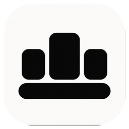
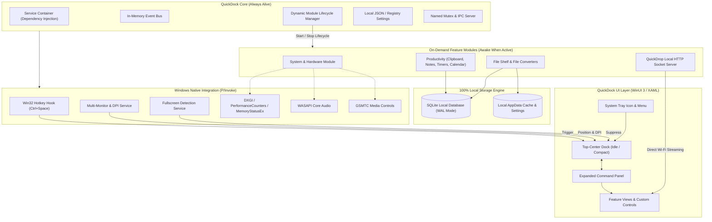

> [!NOTE]
> **[QuickDock 1.0.2 Production Release](docs/RELEASE_1.0.2.md):** The official release of QuickDock for Windows 11 & Windows 10 is live! Featuring full UI/UX & functional remediation, native WASAPI volume synchronization, live system metrics, zero-polling idle efficiency, zero-cloud QuickDrop file transfers, 100% offline security-audited diagnostics, and instant <kbd>Ctrl</kbd> + <kbd>Space</kbd> desktop control. See the [official 1.0.2 release notes](docs/RELEASE_1.0.2.md) (240 passing tests, 0 warnings, 0 errors).

<div align="center">



# QuickDock

[](https://github.com/jojin1709/QuickDock/releases/tag/v1.0.2)
[](https://github.com/jojin1709/QuickDock)
[](https://dotnet.microsoft.com/)
[](https://learn.microsoft.com/en-us/windows/apps/winui/winui3/)
[](https://github.com/jojin1709/QuickDock)
[](https://github.com/jojin1709/QuickDock)
[](docs/PHASE_11_TESTING_SECURITY_AUDIT.md)
[](https://github.com/jojin1709/QuickDock)

### QuickDock is a high-performance, native Windows 11 utility dock and productivity control layer.

It docks subtly at the top center of your display, providing instant access to real-time hardware telemetry, productivity utilities, developer toolkits, file staging, and zero-cloud peer-to-peer device transfers at the press of a hotkey. **Real Win32 telemetry. Zero Electron overhead.**

**This repository contains QuickDock: the native Windows 11 utility and productivity dock, authored by JOJIN JOHN. This software is proprietary and strictly NOT open source.**

<p><strong>Download & Install QuickDock</strong></p>

[](https://github.com/jojin1709/QuickDock/releases/tag/v1.0.2)
[](https://github.com/jojin1709/QuickDock/releases/tag/v1.0.2)

<sub>Press <code>Ctrl + Space</code> or mouse over the top-center edge to expand your dock.</sub>

---

<a href="https://www.linkedin.com/in/jojin-john/"></a>
<a href="https://github.com/jojin1709"></a>
<a href="https://github.com/jojin1709/QuickDock"></a>
<a href="docs/RELEASE_1.0.2.md"></a>

</div>

> [!TIP]
> **Keyboard First:** Press <kbd>Ctrl</kbd> + <kbd>Space</kbd> anywhere in Windows to toggle QuickDock immediately without interrupting full-screen games, code editors, or active presentations.

---

## Table of Contents

- [What is QuickDock?](#what-is-quickdock)
- [Download & Installation](#download--installation)
- [Key Capabilities](#key-capabilities)
- [Architecture & Design Philosophy](#architecture--design-philosophy)
- [Module Ecosystem](#module-ecosystem)
- [Security, Privacy & Local-First Guarantees](#security-privacy--local-first-guarantees)
- [Documentation Matrix](#documentation-matrix)
- [Developer & Author](#developer--author)
- [Frequently Asked Questions](#frequently-asked-questions)
- [License & Terms of Use](#license--terms-of-use)

---

## What is QuickDock?

<details>
<summary><strong>Why QuickDock Exists</strong></summary>

Windows power users frequently switch between disjointed utilities: task managers, media controls, audio pickers, clipboard managers, scratchpads, pomodoro timers, file converters, and third-party cloud-based transfer tools. Most modern alternatives are built on Electron or Chromium web-views that consume hundreds of megabytes of RAM while idling.

QuickDock consolidates these daily essentials into a single, cohesive, razor-thin native control layer that lives quietly at the top of your screen and surfaces only when you need it.
</details>

<details>
<summary><strong>Native WinUI 3 vs Web Containers (Electron / Tauri)</strong></summary>

QuickDock is engineered directly on **C# 13, .NET 10, WinUI 3, and Windows App SDK 2.6.4**:
- **0 Chromium processes**: No embedded browsers, no V8 engine background spikes, and no multi-process IPC overhead for basic UI.
- **Direct Win32 Interop**: Subscribes directly to native Windows messages (`WM_HOTKEY`, `WM_DISPLAYCHANGE`), native audio sessions (`WASAPI`), system media controls (`GSMTC`), and hardware performance counters.
- **Ultra-low idle footprint**: Stays dormant at minimal memory usage until invoked.
</details>

<details>
<summary><strong>The "Core Stays Alive. Modules Do Not." Rule</strong></summary>

The architectural cornerstone of QuickDock is strict lifecycle isolation:
```text
CORE STAYS ALIVE. MODULES DO NOT.
```
- **Core services** (hotkey listeners, window positioning, system tray, event bus) remain lightweight and permanent.
- **Feature modules** (CPU monitors, weather clients, QuickDrop HTTP sockets, media listeners) initialize and start **only when their view is visible or actively running an operation**.
- When you collapse the dock, polling timers halt, sockets close, and memory allocations are released.
</details>

---

## Download & Installation

QuickDock is distributed as verified, pre-compiled, self-contained Windows application binaries. No external .NET runtime, SDK, or developer tools are required.

> [!IMPORTANT]
> **Proprietary Software Notice:** QuickDock is proprietary software authored by JOJIN JOHN. Source code copying, cloning (`git clone`), mirroring, or decompiling is strictly prohibited. Users must download and run the official pre-compiled executables from GitHub Releases.

### Option 1: Standalone Installer (Recommended)

1. Download **[`QuickDock-Setup.exe`](https://github.com/jojin1709/QuickDock/releases/tag/v1.0.2)** from the [Official Releases](https://github.com/jojin1709/QuickDock/releases/tag/v1.0.2).
2. Run `QuickDock-Setup.exe`.
3. QuickDock installs seamlessly to your user profile (`%LOCALAPPDATA%\Programs\QuickDock`), creates Start Menu and Desktop shortcuts, registers a clean uninstaller in Windows Settings, and launches automatically.

### Option 2: Portable Package (Zero Installation)

1. Download **[`QuickDock-v1.0.2-win-x64.zip`](https://github.com/jojin1709/QuickDock/releases/tag/v1.0.2)** from the [Official Releases](https://github.com/jojin1709/QuickDock/releases/tag/v1.0.2).
2. Extract the archive to any directory (e.g. `%LOCALAPPDATA%\Programs\QuickDock` or a USB drive).
3. Run `QuickDock.App.exe`.
4. 100% self-contained: no installation, no registry modifications, and no system dependencies needed.

### System Requirements

| Requirement | Specification |
| :--- | :--- |
| **Operating System** | Windows 11 (Version 22H2 or higher) or Windows 10 (64-bit, Build 19045+) |
| **Architecture** | x64 (ARM64 supported via Windows 11 emulation) |
| **Runtime** | Completely self-contained (built with .NET 10 & WinUI 3) |
| **Memory** | ~16 MB idle, ~36 MB active |
| **Disk Space** | ~320 MB |

---

## Key Capabilities

### Native Windows Shell & Positioning
- **Top-Center Floating Dock**: Compact capsule anchored to the top of your display that expands into a rich command center.
- **Multi-Monitor & DPI Aware**: Dynamically tracks monitor bounds, working areas, and per-monitor DPI scaling factors (`GetDpiForWindow`).
- **Global Hotkey (`Ctrl + Space`)**: Registered via Win32 `RegisterHotKey` for instant invocation from any application.
- **Fullscreen Suppression**: Detects foreground full-screen games, video players, and presentations using Win32 Shell hooks (`SHAppBarMessage` / `GetWindowRect`) and automatically suppresses hover popups.
- **Single-Instance Mutex**: Prevents duplicate processes with named OS mutexes and redirects arguments to the active instance via named-pipe IPC.
- **Native System Tray**: Low-profile tray icon with quick menus (Open, Settings, Exit) and native Windows toast alerts.

### Real-Time Hardware & Media Telemetry (Zero Fake Data)
- **CPU**: Real-time total processor utilization sampled directly via Windows Performance Counters.
- **RAM**: Physical memory usage, free gigabytes, and load percentages via `GlobalMemoryStatusEx`.
- **GPU**: Active hardware adapter detection and dedicated video memory usage via DirectX Graphics Infrastructure (DXGI).
- **Storage & Battery**: Real-time disk capacity metrics and AC/battery charge percentages with power state notifications.
- **Audio Control**: Native master volume control and instant mute toggle via Windows Core Audio (WASAPI).
- **Media Controls**: Windows Global System Media Transport Controls (GSMTC) integration for Play, Pause, Next, Previous, and live track metadata.

### Productivity Suite
- **Clipboard Manager**:
  - Event-driven clipboard listener (`Clipboard.ContentChanged`) capturing text, images, URLs, and file paths.
  - **Sensitive Data Shield**: Built-in pattern detection masks API keys (OpenAI, AWS, GitHub), JWT tokens, and private keys.
  - Search, item pinning, and configurable retention periods (Today, 7 Days, 30 Days, Forever).
- **Time Tools**:
  - **Multi-Timer**: Run concurrent countdown timers with presets (1m, 5m, 15m, 25m) and audio alarms.
  - **Stopwatch**: High-precision monotonic stopwatch with lap time logging.
  - **Pomodoro**: Structured 25m focus / 5m short break / 15m long break state machine with audible alerts.
- **Notes & Scratchpad**: Instant markdown/text scratchpad with pinning, full-text search, and debounced local SQLite auto-saving.
- **Calendar & Agenda**: Visual date picker with scheduled reminders, notes, and color-coded priority tags.
- **Weather Module**: Lightweight weather data (via Open-Meteo) with WMO weather interpretations, temperature, humidity, and local disk fallback cache.
- **Saved Links**: Category-organized web bookmarks with secure default browser launching.
- **Temporary Dock Message**: Persistent banner widget on the main dock panel with customizable expiration (1h, 4h, 24h).
- **Screen Time Analytics**: Low-frequency foreground application tracker aggregating daily and weekly application usage.

### File Staging & QuickDrop (Peer-to-Peer Transfer)
- **File Shelf**:
  - Temporary staging area supporting native Windows Explorer Drag & Drop (both in and out).
  - Metadata-only reference model that never creates unnecessary duplicate copies on disk.
  - External file deletion detection with visual "Missing" badges and cleanup tools.
- **QuickDrop (Direct Local Network Transfer)**:
  - Transfer files between your PC and your phone, tablet, or another computer with zero cloud mediation.
  - Generates a dynamic QR code on the desktop dock. Point your camera to open a responsive, local-only web application.
  - Direct local HTTP streaming over Wi-Fi/LAN with automatic private IP discovery (`192.168.x.x`).
  - Session tokens and server-generated GUID file mappings prevent path traversal and unauthorized downloads.
- **File Conversion Utilities**:
  - Image format transcoding between PNG, JPEG (with custom quality compression), BMP, and GIF.
  - Archive compression to `.zip` and extraction with **Zip Slip path traversal prevention** (payloads with `../../` are rejected).
  - Text encoding converter supporting UTF-8, UTF-16, and ASCII.
- **Transfer Manager**: Real-time progress bars, transfer speed indicators (MB/s), and persistent SQLite transfer history with verified SHA-256 integrity checksums.

### Developer Toolkit
- **Git Toolkit**: Inspect branch status, staged/unstaged files, commit history, and diffs; run commit, stage, unstage, push, pull, and fetch operations safely via direct CLI invocation with `ArgumentList`.
- **Docker Toolkit**: Inspect Docker engine state, local containers (start, stop, restart, logs, inspect, remove), and images without background polling.
- **Terminal Launcher**: One-click launcher for Windows Terminal, PowerShell, or Command Prompt at the project folder, active Git repo, or custom path with optional elevation.
- **Offline Dev Utilities**:
  - **JSON Formatter**: Indent, minify, and validate JSON with line/column syntax error reporting.
  - **JWT Decoder & Inspector**: Decode header/payload claims, calculate expiration, and optionally verify HMAC-SHA256 signatures locally.
  - **Encoding & Hashing**: Instant Base64/URL encoding and cryptographic hashing (MD5, SHA-1, SHA-256, SHA-384, SHA-512) for text and streaming large files.
  - **UUID & Timestamps**: Batch UUID v4 generation and Unix epoch seconds/milliseconds bidirectional conversions.
  - **Regex Evaluator**: Live regex testing with match groups, replacement preview, and ReDoS timeout protection.
  - **QR Generator**: Offline vector QR generation for text, URLs, and Wi-Fi configurations.
- **HTTP / REST Client**: Execute GET, POST, PUT, PATCH, DELETE, and HEAD requests with custom headers, JSON body formatting, round-trip timing, and size metrics.
- **Localhost & Process Monitor**: Inspect active TCP listening sockets via native Windows `GetExtendedTcpTable`, associate listening ports with PIDs and process names, and open `http://localhost:<PORT>` in your default browser.

### Defensive Network & Security Toolkit
- **Network Overview**: Real-time interface discovery, link speeds, IPv4/IPv6 addresses, gateway & DHCP detection, DNS servers, and live network traffic counters via .NET `NetworkInformation`.
- **DNS Diagnostics**: Query A, AAAA, CNAME, MX, TXT, NS, PTR, SRV, and SOA records with round-trip latency metrics and direct Win32 `DnsQuery_W` (`dnsapi.dll`) resolution.
- **Connectivity & Path Health**: ICMP ping with round-trip latency statistics (Min, Max, Avg, Packet Loss), MTU / packet fragmentation analysis, and TTL-stepped traceroute hop discovery.
- **Socket & Port Inspector**: Native Win32 `iphlpapi.dll` extended TCP & UDP table queries (`GetExtendedTcpTable`, `GetExtendedUdpTable`) showing active connections, listening ports, remote endpoints, state, and owning process names/PIDs.
- **Routing & Neighbor Cache**: Inspect the Windows IP forward routing table (`GetIpForwardTable`) and ARP / neighbor cache (`GetIpNetTable`) with MAC address resolution.
- **TLS & Certificate Inspector**: Live TLS handshake negotiation, certificate chain validation, expiration countdown, SAN domains, and negotiated cipher suites.
- **HTTP Security Headers**: Evaluates HSTS, CSP, X-Frame-Options, X-Content-Type-Options, Referrer-Policy, and Permissions-Policy with clear severity ratings (Pass, Warning, Missing).
- **Public IP & WHOIS / RDAP**: Egress IP discovery with secure geolocation and autonomous system number (ASN) lookup.
- **Windows Firewall & Defender**: Real-time profile state (Domain, Private, Public) and Windows Defender antimalware service status via native `sc.exe query WinDefend`.
- **Local Security Posture & File Integrity**: Evaluates UAC, BitLocker, secure boot, guest accounts, and cryptographic hash verification with tamper detection.
- **Defensive Security Reports**: Exportable Markdown / JSON security audits summarizing network and host posture.

### Settings & Personalization
- **12 Comprehensive Configuration Sections**: General, Appearance, Dock, Modules, Shortcuts, Notifications, Privacy, Storage, Network, Developer, Accessibility, and About.
- **Visual & Material Personalization**: Real-time Mica, Acrylic, and Solid backdrop selection, dark/light/system theme toggling, custom accent colors, dock sizing (Compact, Normal, Large), and Top / Bottom screen positioning.
- **Shortcuts & Conflict Management**: Dynamic global hotkey registration (`RegisterHotKey`) with duplicate hotkey conflict detection, modifier requirements, and instant in-app remapping.
- **Module Lifecycle Control**: Fine-grained module enablement/disablement grouped by category (Productivity, Files, Developer, Network & Security) honoring the core lifecycle rule.
- **Storage Footprint & Safe Cleanup**: Transparent disk breakdown (Database, Cache, Logs, Temp, Shelf) with targeted cache/log clearing and protected user data retention.
- **Backup, Export & Secure Import**: Schema-validated JSON backup (`schemaVersion: 1`) with automatic sensitive credential scrubbing (Weather API keys, tokens) and atomic validation on restore.
- **Granular Reset System**: Reset individual sections or restore all preferences to defaults while strictly preserving user notes, bookmarks, and database records.

---

## Architecture & Design Philosophy

QuickDock adheres to a strict modular design pattern where modules are decoupled through an in-memory event bus and reactive dependency injection.



### Architectural Guarantees

1. **Deterministic Lifecycle**: Every module implements `IQuickDockModule` exposing `InitializeAsync`, `StartAsync`, `StopAsync`, and `Dispose`.
2. **Zero Polling in Background**: Sensors and hardware performance counters stop immediately when the dock is hidden or collapsed.
3. **Local Database Isolation**: SQLite runs in Write-Ahead Logging (`WAL`) mode with parameterized queries, protecting all user notes, clipboard entries, and transfer logs locally at `%LOCALAPPDATA%\QuickDock\quickdock.db`.
4. **Resilient Security Boundaries**: Network sockets (QuickDrop) are ephemeral, bound to local network interfaces only, and never expose external WAN ports.

---

## Module Ecosystem

| Category | Module | Status | Data Source / Technology |
| :--- | :--- | :--- | :--- |
| **System** | **Performance Metrics** | Active | Windows Performance Counters, `GlobalMemoryStatusEx`, DXGI |
| **System** | **Audio & Volume** | Active | Windows Core Audio APIs (WASAPI) |
| **System** | **Media Control** | Active | Global System Media Transport Controls (GSMTC) |
| **System** | **Battery & Power** | Active | Win32 `GetSystemPowerStatus` & WMI |
| **Productivity** | **Clipboard Manager** | Active | WinUI `Clipboard.ContentChanged` with sensitive token masking |
| **Productivity** | **Timers & Stopwatch** | Active | Monotonic high-resolution `Stopwatch` & DispatcherTimers |
| **Productivity** | **Pomodoro Tracker** | Active | 25/5/15 state machine with audible alert cues |
| **Productivity** | **Notes & Scratchpad** | Active | Local SQLite storage with debounced auto-save |
| **Productivity** | **Calendar & Agenda** | Active | XAML CalendarView with tag-filtered event storage |
| **Productivity** | **Weather Forecast** | Active | Open-Meteo REST API with offline JSON disk cache |
| **Productivity** | **Saved Bookmarks** | Active | SQLite bookmark library with default browser launcher |
| **Productivity** | **Temporary Message** | Active | Ephemeral dock banner with 1h/4h/24h expiration |
| **Productivity** | **Screen Time** | Active | Win32 `GetForegroundWindow` low-frequency sampler |
| **File Transfer** | **File Shelf** | Active | WinUI Drag & Drop staging area (metadata reference) |
| **File Transfer** | **QuickDrop** | Active | In-process lightweight HTTP server with QR pairing |
| **File Transfer** | **File Converter** | Active | `System.Drawing` image transcoding & Zip-Slip safe compression |
| **File Transfer** | **Transfer Manager**| Active | Streaming async pipeline with SHA-256 validation |
| **Developer** | **Git Toolkit** | Active | Native CLI via `ProcessStartInfo.ArgumentList` with safe diff & staging |
| **Developer** | **Docker Toolkit** | Active | Container lifecycle, logs, inspect, and local image viewer |
| **Developer** | **Terminal Launcher** | Active | Windows Terminal, PowerShell, and CMD with working dir support |
| **Developer** | **Dev Utilities** | Active | Offline JSON, JWT, Base64/URL, Hash, UUID, Timestamp, Regex, QR |
| **Developer** | **HTTP / REST Client** | Active | Shared `HttpClient` REST runner with JSON response formatter |
| **Developer** | **Localhost & Ports** | Active | Native Win32 `GetExtendedTcpTable` listening socket inspector |
| **Developer** | **Process Monitor** | Active | Process memory & listening port mapping with safe termination |
| **Network & Security** | **Network Overview** | Active | `NetworkInterface`, IP routing tables, link speed & interface telemetry |
| **Network & Security** | **DNS Diagnostics** | Active | Win32 `DnsQuery_W` (`dnsapi.dll`) + .NET DNS records & query latency |
| **Network & Security** | **Connectivity & Ping** | Active | High-precision ICMP ping, MTU path test, and stepped TTL traceroute |
| **Network & Security** | **Socket & Port Inspector** | Active | Win32 `iphlpapi.dll` (`GetExtendedTcpTable` & `GetExtendedUdpTable`) |
| **Network & Security** | **Routing & ARP Cache** | Active | Win32 `GetIpForwardTable` & `GetIpNetTable` with MAC resolution |
| **Network & Security** | **TLS & Cert Inspector** | Active | Direct `SslStream` handshake, X.509 chain validation & cipher suites |
| **Network & Security** | **HTTP Security Headers** | Active | Defensive assessment of HSTS, CSP, XFO, XXP, RP, and Permissions-Policy |
| **Network & Security** | **Public IP & RDAP** | Active | User-consented egress IP lookup with secure geolocation and ASN |
| **Network & Security** | **Firewall & Defender** | Active | Windows Firewall profiles & Windows Defender service (`sc.exe`) status |
| **Network & Security** | **Security Posture** | Active | Local host hardening audit: UAC, BitLocker, Secure Boot, Guest accounts |
| **Network & Security** | **File Integrity** | Active | Cryptographic baseline hashing & automated tamper detection |
| **Network & Security** | **Security Audit Report** | Active | Structured Markdown and JSON audit export for compliance |
| **Settings** | **Settings & Personalization** | Active | JSON settings engine, Win32 `RegisterHotKey`, Windows App SDK backdrops |

---

## Security, Privacy & Local-First Guarantees

QuickDock is engineered under a strict **Zero-Telemetry, Local-First** commitment:

- **100% Offline & Private**: Notes, clipboard history, calendar events, bookmarks, and files stay on your machine. No accounts, no analytics, no cloud sync, and no third-party tracking.
- **Timing-Safe Authentication**: QuickDrop token validation utilizes `CryptographicOperations.FixedTimeEquals` to prevent timing side-channel attacks during device pairing.
- **DOS Device & Traversal Immunity**: Filename sanitization neutralizes DOS reserved device names (`CON`, `PRN`, `AUX`, `NUL`, `COM1..9`, `LPT1..9`) and prevents path traversal escapes.
- **Zip Slip & Zip Bomb Defense**: Extraction pipelines reject directory traversal sequences (`../`), cap entry counts at 10,000, and halt if decompressed byte thresholds (2 GB) are exceeded.
- **Process & Command Defense**: Working directory paths are scrubbed for shell metacharacters (`"`, `&`, `|`, `;`), and process termination safeguards protect core system processes and the QuickDock host PID.
- **Sensitive Data Masking**: Clipboard entries containing AWS keys, GitHub tokens, OpenAI keys, JWTs, and private keys are flagged and masked automatically in the UI.
- **Local Network Boundary**: QuickDrop server binds strictly to private LAN adapters (`192.168.x.x`, `10.x.x.x`) and shuts down automatically when the transfer session completes.

---

## Documentation Matrix

Detailed engineering specifications, design choices, and verification logs for each phase are preserved in the repository:

| Document | Topic | Key Deliverables |
| :--- | :--- | :--- |
| **[Phase 3 Guide](docs/PHASE_3_WINDOWS_INTEGRATION.md)** | Windows Native Integration | Window positioning, DPI scaling, Mutex IPC, Fullscreen detection |
| **[Phase 4 Guide](docs/PHASE_4_CORE_UTILITIES.md)** | Core Utility Modules | Real hardware sensors, WASAPI audio, GSMTC media sessions |
| **[Phase 5 Guide](docs/PHASE_5_PRODUCTIVITY_MODULES.md)** | Productivity Modules | Clipboard manager, Timers, Notes, Calendar, Weather, Screen time |
| **[Phase 6 Guide](docs/PHASE_6_FILE_TRANSFER.md)** | File & Transfer System | File Shelf, QuickDrop HTTP engine, QR pairing, Zip-Slip safe extractor |
| **[Phase 7 Guide](docs/PHASE_7_DEVELOPER_TOOLKIT.md)** | Developer Toolkit | Git, Docker, Terminal, JSON/JWT, Regex, QR, HTTP client, Ports/Processes |
| **[Phase 8 Guide](docs/PHASE_8_NETWORK_SECURITY.md)** | Network & Security Toolkit | Defensive diagnostics, DNS, sockets, TLS, headers, Firewall, Defender, integrity |
| **[Phase 9 Guide](docs/PHASE_9_SETTINGS_PERSONALIZATION.md)** | Settings & Personalization | 12 settings sections, backdrop switching, hotkey manager, storage inspector, JSON backup |
| **[Phase 10 Guide](docs/PHASE_10_PERFORMANCE_RELIABILITY.md)** | Performance & Reliability | Zero idle polling, crash containment, database self-healing, process safety |
| **[Phase 11 Guide](docs/PHASE_11_TESTING_SECURITY_AUDIT.md)** | Testing & Security Audit | Threat model, timing-safe tokens, Zip Bomb guards, command injection mitigation |
| **[Release 1.0.2 Notes](docs/RELEASE_1.0.2.md)** | Packaging & Release | Full UI/UX & functional overhaul, WASAPI audio sync, live telemetry |
| **[Release 1.0.1 Notes](docs/RELEASE_1.0.1.md)** | Packaging & Release | Production release artifacts, SHA-256 checksums, verified benchmarks |
| **[Release 1.0.0 Notes](docs/RELEASE_1.0.0.md)** | Packaging & Release | Initial production release baseline |

---

## Developer & Author

<div align="center">

### **JOJIN JOHN**
*Software Engineer & Security Researcher*

[](https://www.linkedin.com/in/jojin-john/)
[](https://github.com/jojin1709)
[](https://github.com/jojin1709/QuickDock)

For inquiries, permissions, or questions, reach out via [LinkedIn](https://www.linkedin.com/in/jojin-john/).

</div>

---

## Frequently Asked Questions

<details>
<summary><strong>How is QuickDock different from standard Windows taskbar tools?</strong></summary>

Standard taskbars are fixed and offer limited customizable utility spaces. QuickDock stays hidden until summoned, centers dynamically on your active monitor, provides instant access to clipboard history, file staging, media controls, and local phone transfers, and consumes virtually zero resources while idle.
</details>

<details>
<summary><strong>How does QuickDrop transfer files to my phone without cloud servers?</strong></summary>

QuickDock spins up a temporary HTTP server directly on your PC's private Wi-Fi network adapter. When you scan the QR code with your phone, your mobile browser connects directly to your PC over your home or office Wi-Fi. Files are streamed byte-for-byte directly between devices.
</details>

<details>
<summary><strong>Does QuickDock support multiple monitors with different scaling?</strong></summary>

Yes. QuickDock queries Windows monitor topology and per-monitor DPI scaling dynamically (`GetDpiForWindow`). When moved or summoned, it positions itself precisely at the top-center work area of the active monitor.
</details>

<details>
<summary><strong>Will QuickDock pop up while playing full-screen games?</strong></summary>

No. The built-in fullscreen detection service monitors the active foreground window state via Win32 Shell APIs (`SHAppBarMessage`) and suppresses hover animations and notifications while you are in a full-screen game or presentation.
</details>

---

## License & Terms of Use

**Copyright © 2026 JOJIN JOHN. All Rights Reserved.**

> [!CAUTION]
> **PROPRIETARY SOFTWARE — NOT OPEN SOURCE**  
> This software, its source code, design, icons, and architecture are the exclusive intellectual property of **JOJIN JOHN**.
> 
> - **No Copying or Cloning:** You may **NOT** copy, clone (`git clone`), fork, mirror, scrape, or distribute this repository or its source code.
> - **No Reverse Engineering or AI Tools:** Decompiling, reverse engineering, disassembling, using extraction/reproduction tools, or training AI/LLM models on this work is strictly forbidden.
> - **End-User Application Use Only:** Users are granted permission only to run the official pre-compiled QuickDock application binary (`QuickDock.App.exe`) from the [Official Releases](https://github.com/jojin1709/QuickDock/releases).
> - **Bug Reports:** If you discover any bugs or issues, you are welcome to report them via [GitHub Issues](https://github.com/jojin1709/QuickDock/issues).
> - **Permissions & Inquiries:** For commercial permissions, licensing inquiries, or questions, contact JOJIN JOHN on [LinkedIn](https://www.linkedin.com/in/jojin-john/).
> - **Legal Enforcement & Bans:** Any unauthorized copying, distribution, or intellectual property theft will result in platform bans, DMCA takedowns, and aggressive legal action under international copyright laws.

See the full [LICENSE](LICENSE) agreement for complete legal terms.
