# QuickDock — Phase 3: Windows Integration

## 1. Overview

Phase 3 establishes native Windows integration for QuickDock, transforming it from a standard desktop window into an unobtrusive, multi-monitor-aware, always-on-top utility layer that seamlessly aligns with Windows 11 Fluent design and system behaviors.

---

## 2. Architecture & Components

```mermaid
graph TD
    subgraph UI ["WinUI 3 Shell"]
        MW["MainWindow"]
        SV["SettingsView"]
        HV["HomeView"]
    end

    subgraph Core ["QuickDock.Core"]
        IMS["IMonitorService"]
        IWPS["IWindowPositioningService"]
        IFS["IFullscreenService"]
        ISS["IStartupService"]
        INS["INotificationService"]
        IST["ISystemTrayService"]
        HOTKEY["IGlobalHotkeyService"]
        SET["ISettingsManager"]
        BUS["IEventBus"]
    end

    subgraph Infra ["QuickDock.Infrastructure.Windows"]
        MS["MonitorService<br/>(EnumDisplayMonitors, GetMonitorInfoW, GetDpiForMonitor)"]
        WPS["WindowPositioningService<br/>(DPI math, Work Area placement, TopMost)"]
        FS["FullscreenDetectionService<br/>(SetWinEventHook, Foregound & Rect Check)"]
        SS["StartupService<br/>(HKCU Run Registry Key)"]
        NS["NotificationService<br/>(Shell Tray Ballon / Toast)"]
        STS["SystemTrayService<br/>(Win32 Shell Notify Icon + Subclass Menu)"]
        GHS["GlobalHotkeyService<br/>(RegisterHotKey Ctrl+Space)"]
        NAT["NativeMethods<br/>(Win32 P/Invokes & Structs)"]
    end

    MW --> IWPS
    MW --> IMS
    MW --> IFS
    MW --> ISS
    MW --> INS
    MW --> IST
    MW --> HOTKEY
    MW --> SET
    MW --> BUS

    WPS --> IMS
    WPS --> NAT
    MS --> NAT
    FS --> NAT
    STS --> NAT
    SS --> NAT
    NS --> NAT
```

---

## 3. Key Capabilities Implemented

### 3.1 Multi-Monitor & DPI Positioning
- **Monitor Detection (`IMonitorService` / `MonitorService`)**:
  - Uses Win32 `EnumDisplayMonitors` and `GetMonitorInfoW` (`MONITORINFOEX`) to discover monitor bounds, work area (`rcWork` excluding taskbar and docked toolbars), primary monitor status, and device names.
  - Queries `GetDpiForMonitor` (`MDT_EFFECTIVE_DPI`) to compute the real per-monitor DPI scale factor (1.0x to 2.0x+).
  - Identifies active monitor dynamically from the foreground window or cursor position (`MonitorFromWindow` / `MonitorFromPoint`).
  - Supports display targets: `Follow active monitor`, `Primary monitor`, or specific monitors (`Monitor 1`, `Monitor 2`, etc.).
- **Calculated Placement (`WindowPositioningService`)**:
  - Horizontal centering: `X = WorkArea.X + (WorkArea.Width - DockWidth) / 2`.
  - Scaled margins: `TopMargin = 12 * ScaleFactor`.
  - Works across 1080p, 1440p, 4K, ultrawide (21:9 / 32:9), and portrait orientations.
  - Subclasses `WM_DPICHANGED` (0x02E0) to instantly resize and reposition dock without scaling artifacts.

### 3.2 Focus Management & Focus Restoration
- QuickDock operates in idle mode without stealing focus.
- When expanding via hover, click, hotkey (`Ctrl+Space`), or system tray, the active foreground application HWND is captured (`GetForegroundWindow()`).
- On collapse (via `Esc`, clicking outside, deactivation, or hotkey), focus is restored immediately to the previous foreground application (`SetForegroundWindow(_previousForegroundHwnd)`).

### 3.3 Alt+Tab Suppression
- Utilizes Windows App SDK `AppWindow.IsShownInSwitchers = false;` to suppress QuickDock from the Alt+Tab task switcher and taskbar, behaving strictly as a desktop utility layer.

### 3.4 Always-On-Top Z-Order
- Controlled via `AlwaysOnTop` setting (Default: `true`).
- Window configured with `HWND_TOPMOST` / `WS_EX_TOPMOST`.
- Dynamically toggles between `HWND_TOPMOST` and `HWND_NOTOPMOST` via `SetWindowPos` when toggled from Settings.

### 3.5 Fullscreen Auto-Hide (`IFullscreenService`)
- Event-driven monitoring using Win32 `SetWinEventHook` listening to `EVENT_SYSTEM_FOREGROUND` (0x0003) and `EVENT_OBJECT_LOCATIONCHANGE` (0x800B). Zero CPU utilization at idle.
- Compares foreground window rect with monitor display boundary (`rcMonitor`). Excludes desktop shell windows (`Progman`, `WorkerW`, `Shell_TrayWnd`).
- When a game, presentation, or video is fullscreen on the monitor:
  - If `HideInFullscreen` is enabled (Default: `true`), QuickDock automatically collapses and hides (`AppWindow.Hide()`).
  - When fullscreen application exits or loses focus, QuickDock restores automatically (`AppWindow.Show()`) and repositions.

### 3.6 Single-Instance Enforcement
- Uses named Mutex `Global\QuickDock_SingleInstance_{UserName}`.
- If an existing instance is running:
  - Registers custom broadcast message: `RegisterWindowMessageW("QUICKDOCK_ACTIVATE_INSTANCE")`.
  - Posts message to bring existing instance to front: `PostMessageW(HWND_BROADCAST, ...)`.
  - Second process terminates immediately with exit code 0.
- Existing `MainWindow` subclass catches `QUICKDOCK_ACTIVATE_INSTANCE` and triggers `ViewModel.Expand(); BringToFront();`.

### 3.7 Windows Startup (`IStartupService`)
- Manages registry value under `HKCU\Software\Microsoft\Windows\CurrentVersion\Run`.
- Command line formatted with `--silent` flag: `"\"path\\QuickDock.App.exe\" --silent"`.
- Supports toggling from both Settings UI and System Tray context menu.

### 3.8 Notifications (`INotificationService`)
- Implements `NotificationService` supporting Win32 system tray balloon notifications (`szInfo`, `szInfoTitle`, `NIF_INFO`, `NIIF_INFO`) and structured file logging with graceful failure handling.

### 3.9 System Tray Enhancements
- Win32 tray context menu contains:
  - `Toggle QuickDock` (Show/Hide)
  - `Settings`
  - [Separator]
  - `Start with Windows` (with live checkbox state)
  - `Performance Mode`
  - [Separator]
  - `About QuickDock`
  - [Separator]
  - `Restart QuickDock`
  - `Exit QuickDock`

---

## 4. Verification

- **Solution Build**: 0 warnings, 0 errors.
- **Unit Test Coverage**: 45 passed, 0 failed.
  - Multi-resolution placement (1080p, 1440p, 4K, ultrawide, portrait).
  - DPI scaling factors (100%, 125%, 150%, 175%, 200%).
  - Fullscreen bounding evaluation logic.
  - Startup command line formatting.
  - Multi-monitor enumeration and selection.
  - System metrics sampling and event bus dispatching.
- **Runtime Verification**:
  - Primary process launch succeeds and captures Mutex.
  - Secondary process launch detects existing instance and exits immediately with code 0.
  - Full application lifecycle, logging, and settings persistence verified.
